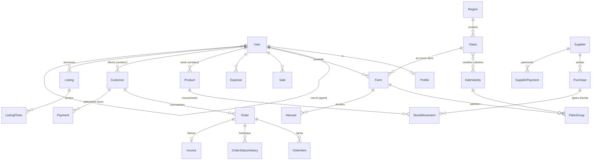
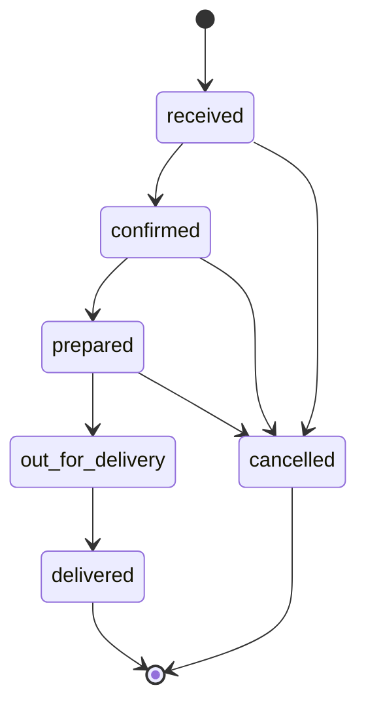

# T02 – Schéma de la base de données Wahaty

Version 1 – 14 octobre 2026 – **validée** (réponses en section 14)

Ce document décrit toutes les tables, leurs champs et leurs règles. Les noms techniques (tables, champs) sont en anglais, comme le veut l'usage Django ; les explications sont en français. Les questions à trancher sont regroupées en section 14.

---

## 0. Conventions communes à toutes les tables

| Règle | Détail |
| --- | --- |
| Identifiant | `id` : nombre entier automatique (BigAutoField). |
| Dates techniques | `created_at` (création) et `updated_at` (dernière modification), remplies automatiquement. |
| Suppression douce | `is_active` (vrai/faux). On ne supprime jamais une ligne : on la désactive. Exceptions signalées. |
| Argent | `DecimalField(12 chiffres, 2 décimales)` en **MRU**. Jamais de `float`. Montant maximum : 9 999 999 999,99 MRU. |
| Quantités | `DecimalField(10, 2)` en **kg** (ou dans l'unité du produit). Toujours ≥ 0, contrôlé par la base (contrainte `CHECK`). |
| Textes publics | Deux champs : `_ar` (arabe) et `_fr` (français). Le champ arabe est obligatoire, le français aussi (voir question Q1). |
| Propriétaire | Chaque donnée privée a un champ `owner` (utilisateur). Toutes les requêtes de l'API filtrent sur ce champ, sauf pour la Direction. |
| Liens vers l'argent et le stock | `on_delete=PROTECT` : impossible d'effacer un client, un produit ou un fournisseur qui a de l'historique. |
| Téléphones | Format international `+222XXXXXXXX` (8 chiffres après +222). |

**Note technique :** Django impose de créer le modèle `User` personnalisé **avant** la première migration. La base locale `wahaty` (vide) sera donc supprimée puis recréée au début de T03. Aucune donnée n'est perdue.

---

## 1. Vue d'ensemble des liens

---

## 2. Application `accounts` – comptes

### User (utilisateur)

| Champ | Type | Règle |
| --- | --- | --- |
| phone | texte 13 | **Unique**, sert d'identifiant de connexion. |
| password | texte | Haché par Django (jamais en clair). |
| full_name | texte 150 | Obligatoire. |
| roles | liste de choix | Un ou plusieurs parmi `direction`, `farmer` (agriculteur), `seller` (vendeur), `field_agent` (agent de terrain). **Un même compte peut être agriculteur et vendeur** (Q2). Contrainte : `direction` et `field_agent` ne se combinent avec aucun autre rôle. Au moins un rôle obligatoire. |
| preferred_language | choix | `ar` ou `fr`. Par défaut `ar`. |
| status | choix | `pending` (en attente), `approved` (validé), `suspended` (suspendu). Voir Q3. |
| registered_by | lien → User | L'agent qui a inscrit cet agriculteur. Vide sinon. |
| claimed_at | date-heure | Date où l'agriculteur a pris la main sur son compte. Vide = l'agent gère encore. Dès que rempli, l'agent passe en **lecture seule**. |
| is_active, is_staff, last_login, date_joined | | Champs standards Django. |

Règles :
- Un agent ne peut créer que des comptes avec le rôle `farmer`.
- Un agriculteur peut demander le rôle `seller` en plus (et inversement) ; la Direction valide.
- Un compte agriculteur + vendeur voit ses deux espaces ; ses ventes, dépenses et annonces restent dans les mêmes tables (champ `owner`).
- La Direction se connecte aussi au panneau d'administration Django (`is_staff`).

### Profile (profil)

| Champ | Type | Règle |
| --- | --- | --- |
| user | lien 1–1 → User | |
| whatsapp | texte 13 | Facultatif. Si vide, on utilise `phone`. |
| oasis | lien → Oasis | Facultatif (oasis de rattachement). |
| address | texte | Facultatif. |
| photo | image | Facultatif (Cloudinary, T05). |
| business_name | texte 150 | Pour les vendeurs : nom de la boutique (apparaît sur les factures). |

---

## 3. Application `core` – réglages de la Direction

### PlatformSettings (une seule ligne)

| Champ | Type | Défaut | Rôle |
| --- | --- | --- | --- |
| premium_threshold | argent | 100 000 MRU (à confirmer, Q7) | Seuil d'achat pour devenir client Premium. |
| new_customer_days | entier | 30 | Durée « nouveau client ». |
| loyal_min_orders | entier | 3 | Nombre de commandes pour être « fidèle ». |
| loyal_period_days | entier | 180 | Période observée pour « fidèle » (6 mois). |
| inactive_days | entier | 90 | Sans commande depuis… = inactif. |

Modifiable uniquement par la Direction. Tous les seuils du classement sont réglables sans toucher au code.

---

## 4. Application `oases` – oasis et dattes (public)

### Region

| Champ | Type | Règle |
| --- | --- | --- |
| name_ar, name_fr | texte 100 | Obligatoires, uniques. |
| slug | texte | Identifiant pour les adresses web (ex. `adrar`). Unique. |
| order | entier | Ordre d'affichage. |

### Oasis

| Champ | Type | Règle |
| --- | --- | --- |
| region | lien → Region | PROTECT. |
| name_ar, name_fr | texte 150 | Obligatoires. |
| slug | texte | Unique. |
| description_ar, description_fr | texte long | Facultatif. |
| latitude, longitude | décimal (9,6) | Facultatifs. Latitude entre -90 et 90, longitude entre -180 et 180. |
| varieties | liens multiples → DateVariety | Variétés cultivées dans cette oasis. |

### OasisPhoto

| Champ | Type | Règle |
| --- | --- | --- |
| oasis | lien → Oasis | Suppression de la photo autorisée (pas d'argent). |
| image | image | Cloudinary. |
| caption_ar, caption_fr | texte 200 | Facultatifs. |
| order | entier | Ordre d'affichage. La première est la photo principale. |

### DateVariety (variété de dattes)

| Champ | Type | Règle |
| --- | --- | --- |
| name_ar, name_fr | texte 100 | Obligatoires, uniques (ex. أمهات / Amhat). |
| slug | texte | Unique. |
| description_ar, description_fr | texte long | Caractéristiques (goût, couleur, usage). |
| texture | choix | `soft` (molle), `semi_dry` (demi-sèche), `dry` (sèche). |
| ripening_start_month, ripening_end_month | entier 1–12 | Saison de maturité. Peut passer d'une année à l'autre (ex. novembre → février). |
| photo | image | Facultatif. |

---

## 5. Application `farms` – agriculteurs

### Farm (ferme)

| Champ | Type | Règle |
| --- | --- | --- |
| owner | lien → User (agriculteur) | PROTECT. |
| oasis | lien → Oasis | PROTECT. |
| name | texte 150 | Obligatoire. |
| area_hectares | décimal (8,2) | Facultatif, ≥ 0. |
| latitude, longitude | décimal (9,6) | Facultatifs. |
| created_by | lien → User | Qui a saisi (l'agriculteur ou son agent). |

Un agriculteur peut avoir **plusieurs fermes**.

### PalmGroup (palmiers d'une variété dans une ferme)

| Champ | Type | Règle |
| --- | --- | --- |
| farm | lien → Farm | |
| variety | lien → DateVariety | PROTECT. |
| productive_count | entier ≥ 0 | Palmiers en production. |
| young_count | entier ≥ 0 | Jeunes palmiers pas encore productifs (voir Q4). |

Contrainte : **une seule ligne par couple (ferme, variété)**. Total de palmiers d'une ferme = somme des lignes.

### Harvest (récolte)

| Champ | Type | Règle |
| --- | --- | --- |
| farm | lien → Farm | PROTECT. |
| variety | lien → DateVariety | PROTECT. |
| season | entier (année) | Ex. 2026. |
| harvest_date | date | |
| quantity_kg | décimal (10,2) | > 0. |
| notes | texte | Facultatif. |
| created_by | lien → User | |

Production d'une saison = somme des récoltes de cette saison (plusieurs cueillettes possibles).

---

## 6. Application `finance` – ventes, dépenses, paiements

### ExpenseCategory (catégorie de dépense)

| Champ | Type | Règle |
| --- | --- | --- |
| name_ar, name_fr | texte 100 | Ex. eau, engrais, main-d'œuvre, transport, emballage, loyer. |
| applies_to | choix | `farmer`, `seller` ou `both`. |

Liste gérée par la Direction.

### Sale (vente directe)

Vente faite **hors commande** (surtout pour l'agriculteur qui vend sa récolte). Voir Q5 pour les vendeurs.

| Champ | Type | Règle |
| --- | --- | --- |
| owner | lien → User | PROTECT. |
| farm | lien → Farm | Facultatif. |
| variety | lien → DateVariety | Facultatif. |
| sale_date | date | |
| quantity_kg | décimal (10,2) | > 0. |
| unit_price | argent | > 0, prix au kg. |
| total_amount | argent | = quantité × prix, calculé par le serveur. |
| buyer_name | texte 150 | Facultatif. |
| notes | texte | Facultatif. |

### Expense (dépense)

| Champ | Type | Règle |
| --- | --- | --- |
| owner | lien → User | PROTECT. |
| category | lien → ExpenseCategory | PROTECT. |
| farm | lien → Farm | Facultatif. |
| expense_date | date | |
| amount | argent | > 0. |
| description | texte | Facultatif. |

**Bénéfice** (calculé, pas stocké) = total des ventes − total des dépenses, sur une période choisie.

### Payment (paiement reçu d'un client)

| Champ | Type | Règle |
| --- | --- | --- |
| owner | lien → User (vendeur) | PROTECT. |
| customer | lien → Customer | PROTECT. |
| order | lien → Order | Facultatif (paiement d'une commande précise ou acompte général). |
| payment_date | date | |
| amount | argent | > 0. |
| method | choix | `cash` (espèces), `bankily`, `masrvi`, `sedad`, `bank_transfer` (virement), `other`. |
| reference | texte 100 | Facultatif (numéro de transaction). |

---

## 7. Application `inventory` – stock et fournisseurs (vendeur)

### Supplier (fournisseur)

| Champ | Type | Règle |
| --- | --- | --- |
| owner | lien → User (vendeur) | PROTECT. |
| name | texte 150 | |
| phone | texte 13 | Facultatif. |
| oasis | lien → Oasis | Facultatif. |
| notes | texte | Facultatif. |

**Dette fournisseur** (calculée) = total des achats − total des paiements.

### Product (produit)

| Champ | Type | Règle |
| --- | --- | --- |
| owner | lien → User (vendeur) | PROTECT. |
| name | texte 150 | Ex. « Amhat 1er choix – carton 5 kg ». |
| variety | lien → DateVariety | Facultatif. |
| unit | choix | `kg`, `box` (carton), `bag` (sac), `piece`. Voir Q6. |
| sale_price | argent | Prix de vente conseillé par unité. |
| low_stock_threshold | décimal | Facultatif : alerte stock bas. |

**Il n'y a pas de champ « quantité en stock ».** Le stock est toujours calculé à partir des mouvements.

### Purchase (achat chez un fournisseur)

| Champ | Type | Règle |
| --- | --- | --- |
| owner | lien → User | PROTECT. |
| supplier | lien → Supplier | PROTECT. |
| purchase_date | date | |
| reference | texte 50 | Facultatif (n° du bon du fournisseur). |
| total_amount | argent | = somme des lignes, calculé par le serveur. |

Un achat contient une ou plusieurs lignes (= mouvements de stock d'entrée).

### StockMovement (mouvement de stock)

| Champ | Type | Règle |
| --- | --- | --- |
| product | lien → Product | PROTECT. |
| kind | choix | Entrées : `purchase` (achat), `return` (retour client), `adjust_in` (correction +). Sorties : `sale` (livraison d'une commande), `loss` (perte, abîmé), `adjust_out` (correction −). |
| quantity | décimal (10,2) | **> 0**. Le sens (entrée/sortie) vient du `kind`. |
| unit_cost | argent | Obligatoire pour `purchase` (prix d'achat unitaire). |
| purchase | lien → Purchase | Rempli pour `purchase`. |
| order | lien → Order | Rempli pour `sale` et `return`. |
| movement_date | date-heure | |
| note | texte | Obligatoire pour `loss`, `adjust_in`, `adjust_out` (justification). |
| created_by | lien → User | |

Règles :
- **Stock = somme des entrées − somme des sorties.**
- Une sortie est refusée si elle rend le stock négatif. Le contrôle se fait dans une transaction qui **verrouille le produit**, pour que deux ventes simultanées ne passent pas toutes les deux.
- Un mouvement n'est **jamais modifié ni supprimé**. Pour corriger une erreur, on ajoute un mouvement d'ajustement.

### SupplierPayment (paiement à un fournisseur)

| Champ | Type | Règle |
| --- | --- | --- |
| owner | lien → User | PROTECT. |
| supplier | lien → Supplier | PROTECT. |
| purchase | lien → Purchase | Facultatif. |
| payment_date | date | |
| amount | argent | > 0. |
| method | choix | Mêmes choix que `Payment`. |
| reference | texte 100 | Facultatif. |

---

## 8. Application `customers` – clients (vendeur)

### Customer (client)

| Champ | Type | Règle |
| --- | --- | --- |
| owner | lien → User (vendeur) | PROTECT. |
| name | texte 150 | |
| phone | texte 13 | Facultatif ; unique **par vendeur** s'il est rempli. |
| whatsapp | texte 13 | Facultatif. |
| address | texte | Facultatif. |
| city | texte 100 | Facultatif. |
| notes | texte | Facultatif. |

Valeurs **calculées** (non stockées, recalculées à chaque lecture) :
- **Total acheté** = somme des commandes livrées.
- **Dette** = total des commandes livrées − total des paiements (voir Q8).
- **Segment** :

| Ordre de priorité | Segment | Condition (seuils dans PlatformSettings) |
| --- | --- | --- |
| 1 | Inactif | A déjà commandé, mais aucune commande depuis 90 jours. |
| 2 | Premium | Fidèle **et** total acheté ≥ seuil Premium. |
| 3 | Fidèle | ≥ 3 commandes sur les 180 derniers jours. |
| 4 | Nouveau | Première commande il y a moins de 30 jours, ou aucune commande encore. |
| 5 | Occasionnel | Tous les autres (ex. 1 commande il y a 60 jours). Voir Q7. |

Les commandes **annulées ne comptent pas** dans le classement.

---

## 9. Application `orders` – commandes et livraison (vendeur)

### Order (commande)

| Champ | Type | Règle |
| --- | --- | --- |
| owner | lien → User (vendeur) | PROTECT. |
| customer | lien → Customer | PROTECT. |
| number | texte 20 | Unique par vendeur, ex. `CMD-0001`. |
| status | choix | `received`, `confirmed`, `prepared`, `out_for_delivery`, `delivered`, `cancelled`. |
| order_date | date | |
| expected_delivery_date | date | Date de livraison prévue. |
| delivered_at | date-heure | Rempli au passage à `delivered`. |
| delivery_address | texte | Facultatif. |
| delivery_fee | argent | ≥ 0, défaut 0. |
| discount | argent | ≥ 0, défaut 0. |
| subtotal | argent | = somme des lignes (calculé). |
| total_amount | argent | = sous-total + livraison − remise (calculé, ≥ 0). |
| cancel_reason | texte | Obligatoire si annulée. |
| notes | texte | Facultatif. |

**En retard** (calculé à la lecture) = date prévue < aujourd'hui **et** statut ni `delivered` ni `cancelled`.

### Cycle des statuts

- Toute autre transition est **refusée** (ex. `received` → `delivered`, ou revenir en arrière).
- Les lignes ne sont modifiables qu'en statut `received`.
- À `confirmed` : on vérifie que le stock est suffisant (sans encore le retirer).
- À `delivered` : le stock est retiré (un mouvement `sale` par ligne), dans la même transaction que le changement de statut. Si le stock manque, rien n'est enregistré.
- Annulation possible en `out_for_delivery` ? Voir Q9.

### OrderItem (ligne de commande)

| Champ | Type | Règle |
| --- | --- | --- |
| order | lien → Order | |
| product | lien → Product | PROTECT. |
| quantity | décimal (10,2) | > 0. |
| unit_price | argent | Copié du produit au moment de la commande, modifiable. ≥ 0. |
| line_total | argent | = quantité × prix (calculé). |

### OrderStatusHistory (historique des statuts)

| Champ | Type | Règle |
| --- | --- | --- |
| order | lien → Order | |
| from_status, to_status | choix | |
| changed_by | lien → User | PROTECT. |
| changed_at | date-heure | |
| note | texte | Facultatif. |

Ligne jamais modifiée ni supprimée.

### Notification (rappel dans l'application)

Créée par la commande planifiée quotidienne `send_order_reminders` : commandes à livrer demain, commandes en retard. **Affichée uniquement dans la plateforme** (Q10 validée) : pas de SMS ni de WhatsApp automatique.

| Champ | Type | Règle |
| --- | --- | --- |
| user | lien → User | Destinataire. |
| kind | choix | `delivery_due` (livraison demain), `order_late` (en retard), `low_stock` (stock bas). |
| order | lien → Order | Facultatif. |
| message_ar, message_fr | texte | |
| read_at | date-heure | Vide = non lue. |

Pas de doublon : une seule notification par (commande, type, jour).

---

## 10. Application `invoices` – factures (vendeur)

### InvoiceSequence (compteur de numéros)

| Champ | Type | Règle |
| --- | --- | --- |
| owner | lien → User (vendeur) | |
| year | entier | La numérotation **recommence à 1 chaque année** (Q11 validée). Une ligne par (vendeur, année). |
| last_number | entier | Dernier numéro utilisé. |

Le compteur est **verrouillé** pendant la création d'une facture : deux factures créées en même temps ne peuvent pas avoir le même numéro, et il n'y a jamais de trou.

### Invoice (facture)

| Champ | Type | Règle |
| --- | --- | --- |
| owner | lien → User (vendeur) | PROTECT. |
| order | lien 1–1 → Order | PROTECT. Une facture par commande. |
| number | texte 30 | Ex. `FAC-2026-0001`. Unique par vendeur. |
| sequence | entier | Le nombre seul (1, 2, 3…). |
| issue_date | date | |
| seller_snapshot, customer_snapshot | JSON | Copie du nom, téléphone, adresse au moment de la facture (la facture ne change pas si le client change plus tard). |
| lines_snapshot | JSON | Copie des lignes. |
| subtotal, delivery_fee, discount, total_amount | argent | Copiés de la commande. |
| status | choix | `issued` (émise), `cancelled` (annulée). Une facture annulée **garde son numéro** (pas de trou). |
| pdf | fichier | PDF bilingue généré (T11). |

Facture possible seulement pour une commande `confirmed` ou au-delà (Q11 validée).

---

## 11. Application `market` – marché des dattes

### Listing (annonce)

| Champ | Type | Règle |
| --- | --- | --- |
| owner | lien → User (agriculteur ou vendeur) | PROTECT. |
| variety | lien → DateVariety | PROTECT. |
| oasis | lien → Oasis | PROTECT. |
| title | texte 150 | Écrit par l'utilisateur dans sa langue. |
| description | texte | Facultatif. |
| language | choix | `ar` ou `fr` (langue du texte, pour l'affichage RTL). |
| price_per_kg | argent | > 0. |
| quantity_kg | décimal (10,2) | > 0. |
| contact_phone | texte 13 | Par défaut le téléphone du compte. |
| whatsapp_phone | texte 13 | Facultatif. Sert à créer le lien `https://wa.me/222XXXXXXXX`. |
| status | choix | `draft` (brouillon), `pending` (en attente de validation), `published` (publiée), `rejected` (refusée), `sold` (vendue). Voir Q12. |
| rejection_reason | texte | Rempli par la Direction si refusée. |
| published_at | date-heure | |
| reviewed_by | lien → User (Direction) | |

Le public ne voit **que** les annonces `published`.

### ListingPhoto

| Champ | Type | Règle |
| --- | --- | --- |
| listing | lien → Listing | |
| image | image | Cloudinary, redimensionnée avant l'envoi. Maximum 5 photos par annonce. |
| order | entier | |

---

## 12. Application `audit` – journal

### AuditLog

| Champ | Type | Règle |
| --- | --- | --- |
| user | lien → User | Qui. PROTECT. Vide si action automatique (commande planifiée). |
| acting_for | lien → User | Rempli quand un agent agit pour un agriculteur. |
| action | choix | `create`, `update`, `delete` (désactivation), `status_change`, `login`, `login_failed`. |
| object_type | texte | Ex. `orders.Order`. |
| object_id | texte | |
| object_repr | texte 200 | Ex. « Commande CMD-0012 ». |
| changes | JSON | `{"status": ["confirmed", "prepared"]}` : anciennes et nouvelles valeurs. |
| ip_address | adresse IP | Facultatif. |
| created_at | date-heure | Quand. |

Tables journalisées : paiements (`Payment`, `SupplierPayment`), stock (`StockMovement`, `Purchase`), commandes (statut et lignes), factures, comptes (validation, suspension), annonces (validation). Le journal n'est **jamais modifiable**, même par la Direction.

---

## 13. Tableau de bord (aucune table)

Chiffres calculés à la demande à partir des tables ci-dessus :
- **Direction :** nombre d'agriculteurs, de vendeurs, de fermes, de palmiers (par oasis et variété), production totale par saison, annonces publiées, commandes par statut, commandes en retard.
- **Agriculteur :** palmiers, production par saison et variété, ventes, dépenses, bénéfice.
- **Vendeur :** valeur du stock, produits en stock bas, ventes, dépenses, bénéfice, dettes clients, dettes fournisseurs, commandes par statut et en retard.

---

## 14. Questions à trancher (réponds simplement par le numéro)

**Schéma validé le 14 octobre 2026.** Q1 oui (ar + fr obligatoires) · Q2 oui (plusieurs rôles possibles) · Q10 oui (notifications dans la plateforme) · Q11 oui (numéros remis à 1 chaque année, facture dès `confirmed`) · Q3 à Q9 et Q12 à Q14 : propositions ci-dessous acceptées telles quelles.

| N° | Question | Ma proposition |
| --- | --- | --- |
| **Q1** | Pour les oasis et variétés, le français est-il obligatoire ou peut-on remplir seulement l'arabe ? | Arabe obligatoire, français obligatoire aussi (le site est bilingue). |
| **Q2** | Un même utilisateur peut-il être **à la fois agriculteur et vendeur** ? | Oui : ce cas est fréquent. Dans ce cas, un compte peut avoir plusieurs rôles au lieu d'un seul. Sinon, un rôle unique est plus simple. |
| **Q3** | Les nouveaux comptes doivent-ils être **validés par la Direction** avant de pouvoir utiliser l'application ? | Agriculteur et vendeur : validation obligatoire (`pending` → `approved`). Agent de terrain : créé uniquement par la Direction. |
| **Q4** | Faut-il distinguer palmiers **productifs** et **jeunes** ? | Oui (deux nombres). |
| **Q5** | Pour un vendeur, les ventes = les commandes livrées. A-t-il aussi besoin de la table `Sale` pour des ventes rapides sans commande (au comptoir) ? | Non : le vendeur passe toujours par une commande (même livrée tout de suite). `Sale` sert à l'agriculteur. |
| **Q6** | Quelles **unités** pour les produits du vendeur ? | kg, carton, sac, pièce. |
| **Q7** | Seuil Premium de départ ? Et le segment « **Occasionnel** » (ni nouveau, ni fidèle, ni inactif) te convient-il ? | 100 000 MRU, réglable. « Occasionnel » ajouté. |
| **Q8** | La dette d'un client compte quelles commandes : seulement les **livrées**, ou aussi les confirmées ? | Seulement les livrées. |
| **Q9** | Peut-on **annuler** une commande déjà **en livraison** ? Et gérer un **retour** après livraison ? | Annulation possible jusqu'à `prepared`. Retour après livraison : mouvement de stock `return` + avoir, plus tard si besoin. |
| **Q10** | Les rappels de retard : comment sont-ils envoyés ? | Notification **dans l'application** (gratuit). Les SMS et WhatsApp automatiques sont **payants**, donc pas au début. |
| **Q11** | Les numéros de facture recommencent-ils à 1 **chaque année** (`FAC-2026-0001`) ou continuent-ils toujours (`FAC-0001`) ? Facture dès la confirmation ou seulement à la livraison ? | Recommencent chaque année. Facture possible dès `confirmed`. |
| **Q12** | Chaque annonce du marché doit-elle être **validée par la Direction** avant d'être publiée ? | Oui : brouillon → en attente → publiée (ou refusée). |
| **Q13** | Faut-il une **durée de vie** pour les annonces (ex. elles expirent après 30 jours) ? | Non pour l'instant. |
| **Q14** | Un fournisseur peut-il être un **agriculteur inscrit** sur Wahaty (lien entre les deux comptes) ? | Non pour l'instant : le fournisseur est une simple fiche du vendeur. |
